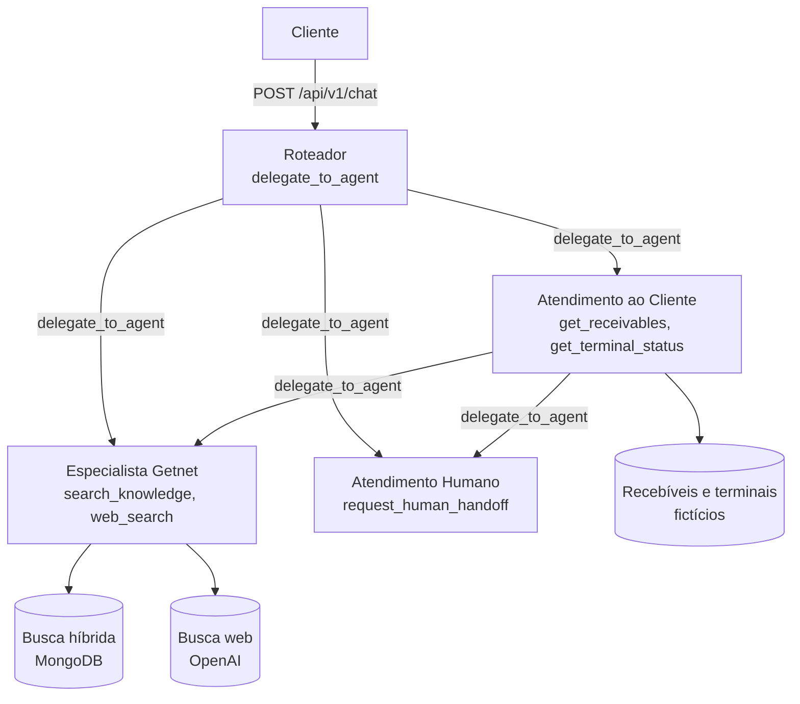
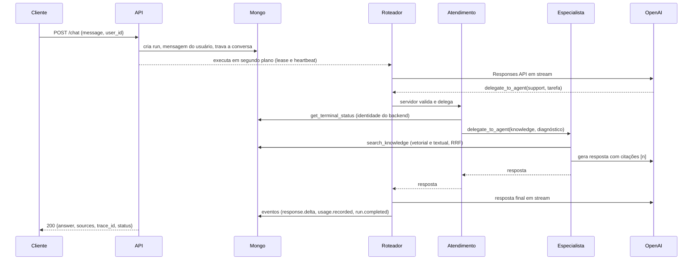
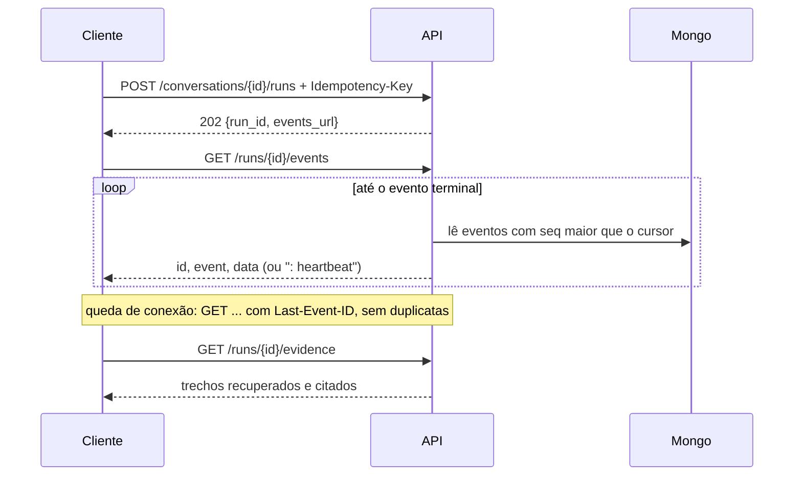

# Atendimento multiagente Getnet

**English summary.** A multi-agent customer-support system for the "AI Hardcore Engineer" challenge. A **Router** agent receives each message and delegates, through a `delegate_to_agent` tool, to a **Knowledge** agent (RAG over curated summaries plus 10 official Getnet pages, hybrid search in MongoDB Atlas Local, and hosted web search for general questions) a **Support** agent (two tools over demo receivables and terminals, always scoped to the identity the backend injects) and a **Human Escalation** agent (a `request_human_handoff` tool that opens a demo handoff ticket with a protocol). Python/FastAPI with a hexagonal layout, OpenAI Responses API with no agent framework, versioned and validated agent graph, durable runs with replayable SSE events, citations validated against the evidence actually retrieved, per-run token and estimated-cost accounting, and a React UI. Run it with `docker compose up -d --build` after putting `OPENAI_API_KEY` in a root `.env`; call `POST /api/v1/chat` with `{"message", "user_id"}`. This README is written in Brazilian Portuguese; code identifiers are in English.

## Sumário

1. [Visão geral](#1-visão-geral)
2. [Construir, configurar e rodar com Docker Compose](#2-construir-configurar-e-rodar-com-docker-compose)
3. [Rodar backend e frontend localmente](#3-rodar-backend-e-frontend-localmente)
4. [Testes](#4-testes)
5. [Arquitetura de orquestração](#5-arquitetura-de-orquestração)
6. [Fluxo de mensagens](#6-fluxo-de-mensagens)
7. [Pipeline RAG](#7-pipeline-rag)
8. [Ferramentas (tools) do LLM](#8-ferramentas-tools-do-llm)
9. [Guardrails](#9-guardrails)
10. [Rastreabilidade, uso e custo](#10-rastreabilidade-uso-e-custo)
11. [Estratégia de testes e testes de integração da orquestração](#11-estratégia-de-testes-e-testes-de-integração-da-orquestração)
12. [Avaliação automatizada](#12-avaliação-automatizada)
13. [Produção e identidade](#13-produção-e-identidade)
14. [Capacidade](#14-capacidade)
15. [Escolhas de design](#15-escolhas-de-design)
16. [API e os 10 exemplos do desafio](#16-api-e-os-10-exemplos-do-desafio)
17. [Resultados da rodada real](#17-resultados-da-rodada-real)
18. [Limitações conhecidas](#18-limitações-conhecidas)
19. [Estrutura do repositório e documentação](#19-estrutura-do-repositório-e-documentação)

## 1. Visão geral

Quatro agentes cooperam; o grafo de delegação é dado versionado, não código:

| Agente | Papel | Ferramentas |
|---|---|---|
| **Roteador** (`router`) | Entrada de todas as mensagens. Decide a quem delegar, consolida e responde no idioma do cliente. | `delegate_to_agent` |
| **Atendimento ao Cliente** (`support`) | Consulta recebíveis e terminais do cliente autenticado; pede ao especialista a orientação de procedimento. | `get_receivables`, `get_terminal_status`, `delegate_to_agent` |
| **Especialista Getnet** (`knowledge`) | Responde dúvidas sobre produtos e procedimentos com RAG e citações; usa a web só para perguntas gerais e atuais (clima, câmbio). | `search_knowledge`, `web_search` |
| **Atendimento Humano** (`escalation`) | Encaminha a um operador humano quando o cliente pede, quando os outros agentes não têm evidência ou não resolvem, ou em assunto sensível (reclamação formal, fraude, contestação). Devolve o protocolo; é uma simulação de demonstração, sem prazo prometido. | `request_human_handoff` |

Grafo inicial: `router → {support, knowledge, escalation}`, `support → {knowledge, escalation}`. A ferramenta `request_human_handoff(reason, summary)` grava um ticket `aberto` na coleção `handoffs` (workspace e usuário vêm da identidade do backend; um ticket por execução; resumo com números longos mascarados) e devolve `{protocol, status, expected_contact}`, com protocolo no formato `ATD-AAAAMMDD-XXXX`.

Além do `POST /chat` pedido no desafio, o sistema tem execuções assíncronas com eventos em tempo real (SSE), histórico de conversas, administração e versionamento dos agentes, gestão da base de conhecimento e uma interface React (marca provisória "Trilha"). O código está em `backend/src/app` (hexagonal), `frontend/src`, `infra/` e `compose.yaml`; as especificações estão em `openspec/changes/sistema-multiagente-atendimento/`.

> Os dados de suporte (recebíveis e terminais) são **fictícios**, e toda resposta que os usa diz isso.

## 2. Construir, configurar e rodar com Docker Compose

Pré-requisitos: Docker com Compose v2 e uma chave de API da OpenAI. A imagem do MongoDB Atlas Local é grande (alguns GB na primeira vez).

**Configurar.** A chave fica em `.env` na raiz; o arquivo está no `.gitignore` e nunca deve ser commitado.

```bash
cp .env.example .env
# edite .env e preencha OPENAI_API_KEY=...
```

`.env.example` documenta todas as variáveis, com padrões. O mesmo `.env` alimenta o Compose e a execução local. Sem a chave, a API sobe, mas `POST /chat` responde `503 provider_not_configured` e a ingestão não gera embeddings.

**Construir e subir.**

```bash
docker compose up -d --build
docker compose ps                                # api e mongo devem ficar "healthy"
curl -s localhost:8000/api/v1/health/ready       # {"status":"ok"}
```

O primeiro início leva alguns minutos (o Atlas Local tem `start_period` de 40 s). Serviços: `mongo` (Atlas Local 8.0.4 com Search e Vector Search), `api`, `worker` (ingestão, mesma imagem), `observability` (Grafana LGTM) e `frontend` (nginx).

| O quê | Onde |
|---|---|
| Interface | http://localhost:8080 |
| API (OpenAPI interativo) | http://localhost:8000/docs |
| MongoDB | `mongodb://localhost:27017/?directConnection=true` |
| Observabilidade (Grafana) | http://localhost:3000/d/getnet-atendimento |

**Ingerir a base de conhecimento (primeira vez).** O worker registra as 20 fontes ao iniciar e um job as processa: 10 sínteses curadas (`data/knowledge/getnet`) e 10 URLs oficiais (coleta pela rede e embeddings `text-embedding-3-small`, que consomem tokens do provedor). Se o catálogo ainda não foi registrado, o `POST` responde `409 no_sources`: aguarde alguns segundos e repita.

```bash
curl -s -X POST localhost:8000/api/v1/knowledge/ingestions        # devolve o job; guarde o "id"
curl -s localhost:8000/api/v1/knowledge/ingestions/<id>            # status: queued, running, partial ou succeeded
docker compose exec api python -m app.adapters.inbound.cli.ensure_indexes --wait 90   # índices de busca consultáveis (apply_indexes aplica todos os índices)
curl -s localhost:8000/api/v1/knowledge/sources                    # 20 fontes; status indexed
```

O resultado esperado é `succeeded`: as dez páginas oficiais e as dez sínteses ficam `indexed`. Uma página que falhar (fora do ar, vazia, bloqueada) deixa o job `partial` sem apagar a versão indexada anterior. Também é possível ingerir pela linha de comando: `docker compose exec worker python -m app.adapters.inbound.cli.ingest_urls [--source ID]` (somente URLs oficiais) e `... ingest_curated /data/knowledge/getnet`.

**Primeira chamada.**

```bash
curl -s -X POST localhost:8000/api/v1/chat -H 'Content-Type: application/json' \
  -d '{"message": "Do I need a bank account to receive my sales via Pix?", "user_id": "cliente1988"}'
```

Parar sem perder dados: `docker compose stop`. Nunca use `docker compose down -v`: ele apaga o banco, e os índices. Backup, restauração e rollback estão em [docs/operacao.md](docs/operacao.md).

## 3. Rodar backend e frontend localmente

Requisitos: Python 3.12 com [uv](https://docs.astral.sh/uv/), Node.js e o Mongo do Compose rodando.

```bash
docker compose up -d mongo                       # só a dependência
```

**Backend** (a configuração vem de `../.env`; o Mongo padrão é `localhost:27017`):

```bash
cd backend
uv sync                                          # cria .venv com as dependências fixadas em uv.lock
PYTHONPATH=src uv run uvicorn app.adapters.inbound.http.main:app --reload --port 8000
```

Com `docker compose up` também rodando a `api`, use outra porta (por exemplo `--port 8001`) ou `docker compose stop api`. O worker de ingestão roda à parte, com o mesmo ambiente:

```bash
cd backend && PYTHONPATH=src uv run python -m app.adapters.inbound.worker
```

**Frontend** (Vite com proxy de `/api` para o backend, SSE incluído):

```bash
cd frontend
npm install
npm run dev                  # http://localhost:5173
```

Variáveis opcionais do shell: `VITE_API_TARGET` (padrão `http://localhost:8000`), `VITE_TIMEZONE` (padrão `America/Sao_Paulo`) e `VITE_DEMO_USER_ID` (padrão `cliente1988`). A interface está descrita em [DESIGN.md](DESIGN.md) e [UX-CONTRACT.md](UX-CONTRACT.md).

## 4. Testes

**Backend** (Python):

```bash
cd backend
.venv/bin/python -m pytest -q          # ou: uv run pytest -q
```

Na primeira verificação desta documentação (03/11/2026), 321 testes passaram em cerca de 40 s com o Mongo do Compose rodando; o total cresce com os testes de cenários de avaliação e de produção (seções 12 e 13). Testes que precisam do Mongo usam um banco temporário de nome único, apagado ao final, e são **pulados** se o Mongo em `localhost:27017` não responder. Testes unitários e de contrato não precisam dele.

**A suíte nunca chama a API real da OpenAI.** O `backend/tests/conftest.py` zera `OPENAI_API_KEY` no ambiente do processo antes de qualquer teste (a variável vazia vence a chave do `.env`, e subprocessos a herdam). Os testes usam doubles do modelo, da busca web e da base. A rodada real (com custo) não usa o pytest: com a stack no ar, rode `cd backend && .venv/bin/python -m evaluation.run_eval --real --max-cases 15 --max-total-tokens 250000`, que exige teto de casos e de tokens. `RUN_REAL_OPENAI=1` só faz o `conftest.py` preservar a chave em testes pytest que você queira rodar contra a API de verdade. Veja [docs/avaliacao.md](docs/avaliacao.md).

**Frontend**:

```bash
cd frontend
npm test            # vitest
npm run lint        # oxlint
npm run build       # tsc -b e vite build
```

Verificado em 03/11/2026: 22 testes do frontend passaram, `npm run lint` e `npm run build` terminaram sem erros.

## 5. Arquitetura de orquestração



Comunicação entre agentes por **chamada de ferramenta**: o Roteador escolhe delegar com `delegate_to_agent(agent_id, task)`; o servidor valida e executa o agente de destino; a resposta dele volta ao chamador como resultado da ferramenta. O destino só vê a `task` escrita pelo chamador, não a conversa, o que força tarefas autocontidas. A cooperação aparece em pedidos que misturam dados do cliente e procedimento ("minha maquininha está sem internet"): Roteador → Atendimento (diagnóstico do terminal) → Especialista (procedimento citado).

- **Grafo versionado e validado.** Agentes e prompts são rascunhos mutáveis (com `revision` e `If-Match`) que se tornam versões imutáveis na publicação; o grafo publicado fixa uma versão por agente. A validação (`check_graph`) recusa destino inexistente ou desativado, auto-vínculo, ciclo (com o caminho), ferramenta desconhecida, destinos sem a tool de delegação e raiz `router` ausente. A publicação é uma transação Mongo com compare-and-set, então duas publicações simultâneas não criam ciclo por corrida. Restaurar cria uma versão nova.
- **Validação no servidor.** O modelo só propõe: o servidor confere que a ferramenta pertence ao agente, que o destino está em `delegates` e no snapshot, que os argumentos são um objeto JSON e que nenhum limite foi atingido.
- **Limites por execução:** profundidade 3, 8 delegações, 12 chamadas de ferramenta, 120 s, 16000 tokens de saída (orçamento conferido a cada chamada ao modelo), além de limites opcionais por agente e 20 execuções ativas por workspace. São salvaguardas ajustáveis em `.env`, não garantia de qualidade. Estourar um limite encerra a execução com erro identificável (`limit_*`).
- **Snapshot por execução.** Cada execução carrega o grafo publicado uma vez e o usa até o fim; publicar durante uma execução não a afeta. A versão do grafo fica registrada no run (`graph_version`) e a de cada agente em `agent.started`.

Detalhes, códigos de erro e decisões em [docs/arquitetura.md](docs/arquitetura.md).

## 6. Fluxo de mensagens

**`POST /chat` (compatível com o desafio).** A API cria a execução, a roda em segundo plano na mesma instância e espera até `CHAT_WAIT_SECONDS` (90 s); responde `200` com a resposta ou `202` com os ids para consulta.



**Execuções assíncronas com SSE.** Para interfaces, `POST /conversations/{id}/runs` (com `Idempotency-Key`) devolve `202` e o cliente acompanha `GET /runs/{id}/events`. Cada evento é gravado no Mongo antes de ser emitido; qualquer instância serve o stream lendo o banco, e o cliente reconecta com `Last-Event-ID` ou `?after=`. Fechar a conexão não cancela a execução: o cancelamento é explícito (`POST /runs/{id}/cancel`).



Eventos: `run.started`, `route.selected`, `agent.started/completed/failed`, `tool.started/completed/failed`, `retrieval.completed`, `response.delta`, `usage.recorded` e `run.completed/failed/cancelled/interrupted`. Esquema, retomada, 410, retenção, lease e idempotência: [docs/eventos.md](docs/eventos.md). Rotas e erros: [docs/api.md](docs/api.md).

## 7. Pipeline RAG

**Ingestão.** Três origens separadas e rotuladas: (1) dez sínteses curadas em `data/knowledge/getnet` (com `manifest.json` e hash do corpo, derivadas das páginas oficiais, não cópias), (2) dez URLs oficiais em `data/knowledge/sources.json` coletadas automaticamente e (3) busca web, que é temporária e nunca vira base. A coleta das páginas aceita apenas `https`, porta 443, hosts da allowlist (`www.getnet.net`, `site.getnet.com.br`, `getstore.getnet.com.br`) em **todos** os saltos de redirecionamento (no máximo 3), exige que o DNS resolva só endereços públicos e conecta ao IP validado (proteção contra SSRF), limita o corpo a 2 MB e aceita apenas HTML. As fases são `collect → extract → chunk → embed → index`, registradas por job.

**Armazenamento.** Um documento por chunk em `knowledge_chunks` (MongoDB), com URL, título, seção, publicador, região, idioma, `retrieved_on`, limitações, hashes, `processing_version`, `index_version`, `embedding_model` e o vetor. O chunking divide por títulos e empacota parágrafos em até 1200 caracteres com 150 de sobreposição, descartando blocos repetidos. Embeddings `text-embedding-3-small` (1536 dimensões) em lotes de 64. A escrita de uma fonte troca chunks e estado numa única transação: uma falha ou uma página vazia nunca sobrescreve a última versão válida (a fonte fica `stale` ou `failed`). Reingestão sem mudança de conteúdo, chunking, modelo ou metadados é `already_current`. A fila é uma coleção Mongo com lease, retry limitado e idempotência, consumida pelo worker.

**Recuperação.** `search_knowledge` gera o embedding da consulta e dispara em paralelo `$vectorSearch` (índice `knowledge_vector`, cosseno) e `$search` (índice `knowledge_text`, analisador `lucene.portuguese`), ambos filtrados por workspace e modelo de embedding, e funde as listas por **reciprocal rank fusion** (k = 60), devolvendo 5 trechos. O `score` é posição na fusão, não probabilidade de acerto.

**Geração.** O especialista recebe cada trecho com `evidence_id` e `cite_as` (`[n]`, único na execução, sem reiniciar a cada busca), URL, data de coleta e limitações. Os prompts mandam fundamentar só nos trechos, citar com `[n]`, declarar evidência insuficiente ou conflitante (por exemplo, o prazo do Pix depende da modalidade) e nunca complementar de memória.

**Evidências recuperadas versus citadas.** O servidor registra tudo o que foi recuperado (`run_evidence`) e, ao final, extrai as citações `[n]` do texto e as **valida** contra os ids realmente recuperados na execução: as válidas viram `sources` da resposta; as inválidas ficam em `invalid_citations` e nunca aparecem como fonte. `GET /runs/{id}/evidence` expõe `retrieved`, `cited` e `invalid_citations`; um trecho recuperado e não citado não é apresentado como fonte. Os eventos carregam só identificadores e metadados, nunca o texto dos trechos.

## 8. Ferramentas (tools) do LLM

Todas são funções **estritas** da Responses API (`strict: true`, `additionalProperties: false`), com descrição específica de quando usar. Cada agente recebe só as suas.

| Ferramenta | Agente | Parâmetros | Retorno |
|---|---|---|---|
| `delegate_to_agent` | Roteador, Atendimento | `agent_id` (enum limitado aos destinos permitidos do agente), `task` | Resposta do agente de destino |
| `request_human_handoff` | Atendimento Humano | `reason` (enum: `cliente_pediu_humano`, `sem_evidencia_suficiente`, `problema_nao_resolvido`, `assunto_sensivel`), `summary` (curto, sem dados sensíveis) | `{protocol, status, expected_contact}`; um ticket por execução; identidade do backend |
| `search_knowledge` | Especialista | `query` | Até 5 trechos com `evidence_id`, `cite_as`, URL, data, limitações, `score` |
| `web_search` | Especialista | `query` | `{status, answer, sources, retrieved_at}`; `status: "unavailable"` em falha |
| `get_receivables` | Atendimento | nenhum | Recebíveis do cliente autenticado (valor, venda, previsão, status), `is_demo`, aviso |
| `get_terminal_status` | Atendimento | nenhum | Terminais do cliente autenticado (modelo, conectividade, erro, operadora), `is_demo`, aviso |

Esquema de `delegate_to_agent` como o modelo o recebe (o `enum` é montado por agente, aqui o do Roteador):

```json
{"type": "object",
 "properties": {"agent_id": {"type": "string", "description": "Identificador do agente de destino.", "enum": ["support", "knowledge"]},
                "task": {"type": "string", "description": "Tarefa completa, com o contexto necessário."}},
 "required": ["agent_id", "task"], "additionalProperties": false}
```

As ferramentas de suporte têm `properties: {}`: **não existe parâmetro de cliente**. O handler ignora qualquer argumento e usa a identidade do contexto autenticado, então um prompt malicioso não consegue consultar outro cliente. Resultados de ferramentas voltam ao modelo como `function_call_output` embrulhados como dado não confiável (próxima seção). Uma falha de ferramenta (banco, provedor) vira um resultado `tool_unavailable` que manda informar a falha sem inventar, e o evento `tool.failed` registra o fato.

## 9. Guardrails

- **Conteúdo não confiável é dado, não instrução.** Resultados de ferramentas, trechos recuperados, respostas da web e respostas de outros agentes chegam entre `<dados_nao_confiaveis origem="...">` e `</dados_nao_confiaveis>`, com a regra de segurança, anexada a todo agente, de nunca obedecer instruções ali contidas. Um fechamento forjado dentro do conteúdo é neutralizado. Teste: injeção em um trecho recuperado não muda permissões nem ferramentas.
- **Identidade do backend.** Nenhuma ferramenta recebe ou aceita identificador de cliente; o `user_id` do corpo só é aceito se igual ao usuário autenticado (`403` caso contrário).
- **Vínculos e permissões no servidor.** Ferramenta fora do agente, destino não vinculado, ciclo e argumentos inválidos são recusados e registrados, sem executar o agente de destino.
- **Limites** de profundidade, delegações, chamadas, tempo, tokens e execuções simultâneas (seção 5), mais limites de tamanho de entrada (mensagem de até 12000 caracteres).
- **Mascaramento.** Números longos (CPF, CNPJ, cartão, conta) nos argumentos de ferramentas viram `[mascarado]` nos eventos, que ainda truncam em 200 caracteres. Telemetria usa lista de campos permitidos; nunca leva mensagens, argumentos, resultados nem trechos.
- **Sem raciocínio exposto.** Os eventos mostram decisões e resultados efetivamente executados; o raciocínio do modelo nunca é emitido nem persistido (só a contagem `reasoning_tokens`).
- **Sem segredos.** Configuração de agentes recusa texto com forma de credencial (`secret_detected`); erros do provedor chegam sanitizados (`502 run_failed` sem detalhe); a chave é um segredo mascarado.
- **Honestidade sobre dados.** Os prompts mandam declarar evidência insuficiente, indisponibilidade de busca e dados de demonstração; Roteador e especialistas nunca respondem de memória sobre dados de cliente, prazos, taxas ou procedimentos. Pedidos ambíguos recebem uma pergunta de esclarecimento; sem resposta possível, a orientação é buscar os canais oficiais da Getnet.

Não há classificador de moderação separado; o encaminhamento a humano é o agente `escalation`, que registra um ticket de demonstração (não há fila de atendimento real; veja as limitações).

## 10. Rastreabilidade, uso e custo

**Observabilidade (OpenTelemetry + Grafana).** A API exporta traces, métricas e logs por OTLP/HTTP para o serviço `observability` do Compose (`grafana/otel-lgtm`: Grafana, Tempo, Loki e Prometheus), ativado por `OTEL_EXPORTER_OTLP_ENDPOINT` (no Compose, `http://observability:4318`; sem a variável, nada é exportado). Falha do coletor nunca afeta o atendimento.

- **Painel:** abra http://localhost:3000/d/getnet-atendimento (dashboard "Atendimento multiagente Getnet": requisições, latência p50/p95, execuções por status, latência por agente e ferramenta, tokens, custo estimado e chamadas sem custo estimável). Na interface, o item "Observabilidade" do menu abre o Grafana em nova aba.
- **Trace de uma execução:** cada execução é um trace (`run` > `agent ...` > `tool ...`). Pegue o `trace_id` em "Detalhes técnicos" (link "Abrir trace no Grafana"), no evento `run.started` ou no cabeçalho `X-Trace-ID` da resposta e cole em Explore > Tempo > TraceID.
- **Logs:** em Explore > Loki, filtre por `service_name="getnet-support-api"` (eventos estruturados de `app.run` com `run_id`, `trace_id`, agente, ferramenta, tokens e custo).
- **Privacidade:** telemetria usa lista de campos permitidos; nunca leva mensagens, argumentos de ferramentas, resultados nem trechos recuperados. Health checks não são rastreados.
- **Frontend:** `VITE_GRAFANA_URL` (padrão `http://localhost:3000`) define o endereço dos links; é lida na compilação.

**Correlação.** `trace_id` é o id do trace da execução (32 hex), devolvido em `POST /chat` e em `GET /runs/{id}` e guardado na execução; aparece em "Detalhes técnicos" do painel. Toda resposta traz `X-Request-ID` e `X-Trace-ID`, e os erros têm o formato `{code, message, request_id}`. Os logs do processo são só avisos e falhas, sem conteúdo de mensagens.

**Custo estimado.** Cada `usage.recorded` leva `usage` (como o provedor informou), `cost_usd` e `pricing_version`, calculados com a tabela versionada em `backend/src/app/domain/pricing.py` (`PRICING_VERSION`, hoje `2026-11-04.1`). O modelo padrão `gpt-6-luna` custa US$ 0,10 por 1M tokens de entrada e US$ 0,50 de saída (referência 17/10/2026). Um modelo fora da tabela tem `cost_usd` `null`, que a API e a interface mostram como "não informado" (nunca zero); para incluí-lo, adicione o preço e incremente `PRICING_VERSION`. A cobrança do provedor é a fonte da verdade.

## 11. Estratégia de testes e testes de integração da orquestração

**Camadas atuais** (`backend/tests`, todas determinísticas, sem rede):

| Camada | O que cobre | Exemplos |
|---|---|---|
| Unitários de domínio | Validação do grafo, versões e diff, chunking, citações, preços, identidade | `test_agents_domain`, `test_knowledge_chunking`, `test_core_evidence`, `test_pricing`, `test_architecture` (o domínio não importa SDK, FastAPI nem Mongo) |
| Orquestração com doubles | Roteamento, delegação, limites, ciclos, injeção, falha de ferramenta, identidade, eventos | `test_core_orchestrator`, `test_orchestrator` |
| Adapters | Coleta segura (SSRF, redirecionamento, tamanho), busca híbrida e RRF, busca web, gateway | `test_knowledge_fetch`, `test_knowledge_search`, `test_model_gateway` |
| Contrato HTTP e SSE | Erros estruturados, idempotência, cursor, 410, UTF-8 fragmentado, heartbeat, cancelamento, lease, isolamento | `test_core_api`, `test_core_errors`, `test_agents_api` |
| Integração com Mongo | Replica set e Search reais, banco temporário: publicação com CAS, ingestão e reindexação, índices de busca, corridas | `test_agents_mongo`, `test_knowledge_mongo`, `test_core_api` |
| Frontend | Lógica de eventos, evidências, markdown, diff e formatação (vitest) | `frontend/src/**/*.test.ts` |
| Regressões reais | Falhas encontradas na rodada real, fixadas como testes | `test_real_run_regressions` |

**Como abordar testes de integração completos da orquestração.** A saída do LLM não é determinística; por isso a verificação se apoia em estrutura, não em redação:

1. **Roteiros do modelo (script).** Um double do `ModelGateway` devolve, por agente, turnos pré-definidos (texto, chamada de ferramenta). O teste exercita o orquestrador, as ferramentas e as regras reais e afirma sobre o que o servidor decide: quem foi chamado, em que ordem, com quais argumentos, quais eventos foram emitidos, o que o modelo recebeu de volta, e se a execução terminou ou falhou com o código esperado. É o padrão de `test_core_orchestrator.py`.
2. **Pilha completa com Mongo real.** O mesmo double ligado ao app FastAPI (`httpx.ASGITransport`) e ao Mongo de teste valida ponta a ponta o contrato: `POST /chat`, runs, SSE, retomada em outra instância, cancelamento, lease, evidências e isolamento entre usuários (`test_core_api.py`).
3. **Falhas injetadas.** Ferramenta indisponível, busca web `unavailable`, evento de erro do modelo, tempo e limites estourados, lease expirado, corrida cancelamento × conclusão. O critério é degradar de forma explícita e sem inventar dados.
4. **Cenários do desafio como dados.** Os dez exemplos do PDF e casos negativos (usuário inexistente, ausência de evidência, conflito entre fontes, injeção, ferramenta fora do ar) formam um dataset versionado que mede roteamento, ferramentas usadas, citações válidas, dados inventados, latência e custo, com doubles no CI e uma rodada real opcional com orçamento. Veja [docs/avaliacao.md](docs/avaliacao.md).
5. **Rodada real opcional.** `python -m evaluation.run_eval --real` contra a API verdadeira, com teto de casos e de tokens, para pegar o que os doubles não pegam (prompts, esquema real de eventos do provedor, latência). A seção 17 registra um exemplo.
6. **Carga e soak.** Execuções concorrentes e streams SSE medidos em separado: [docs/capacidade.md](docs/capacidade.md).

Um teste de integração completo de um cenário, por exemplo "recebíveis de ontem", afirma: o roteador delegou a `support`; `get_receivables` foi chamada sem argumento de cliente e com a identidade do backend; o resultado voltou embrulhado como não confiável; a resposta final traz o valor e a data da fixture e o aviso de demonstração; `usage.recorded` existe para cada chamada; `run.completed` é o último evento e `invalid_citations` é vazio.

## 12. Avaliação automatizada

Dataset versionado de avaliação (`backend/tests/evaluation/dataset_v1.jsonl`, com os cenários do desafio e casos negativos), relatório de roteamento, grounding, erros, latência e custo, execução com doubles e rodada real opcional com orçamento. O procedimento, as métricas e os resultados estão em [docs/avaliacao.md](docs/avaliacao.md).

## 13. Produção e identidade

O perfil `local-demo` (padrão) usa uma identidade fixa sem login. O perfil `production` exige provedor OIDC (`OIDC_ISSUER`, `OIDC_AUDIENCE`), autenticação no servidor, vínculo verificado entre sujeito e workspace, RBAC e nunca confia no `user_id` do corpo. A configuração, o que foi implementado, os testes e o que depende de infraestrutura (TLS, banco compatível com Search, segredos, backups) estão em [docs/producao.md](docs/producao.md).

## 14. Capacidade

A capacidade **não está dimensionada**: nenhum número de capacidade é afirmado sem medição. O plano de benchmark (1, 10 e 50 clientes concorrentes, p50/p95/p99, SSE, banco, uso de modelo, falha de instância), a configuração usada e os resultados, e os critérios para introduzir Redis ou um broker, estão em [docs/capacidade.md](docs/capacidade.md).

## 15. Escolhas de design

| Escolha | Justificativa |
|---|---|
| **Python e FastAPI, arquitetura hexagonal em monólito modular** | Fronteiras claras (`adapters → application → domain`) sem o custo de microsserviços; o domínio é testável sem SDK, e um teste de arquitetura impede que ele importe infraestrutura. |
| **Responses API da OpenAI, sem framework de agentes** | O laço de agentes cabe em um módulo; o servidor mantém o controle de validação, limites, snapshot, eventos e identidade, que um framework esconderia. O custo é implementar streaming e tools à mão, aceitável neste tamanho. |
| **Delegação como ferramenta** | O modelo decide, o servidor valida vínculo, ciclo e limites; o fluxo fica visível nos eventos. |
| **MongoDB Atlas Local com Search e Vector Search** | Um único banco para documentos, busca textual e vetorial, eventos, fila e transações (replica set), reproduzível no Compose. Atlas Local é só desenvolvimento; produção pede um deployment compatível. |
| **Busca híbrida com RRF** | Combina termos exatos (nomes de modelos, códigos) e semântica sem calibrar pontuações incomparáveis. Parâmetros fixos até haver dados de avaliação para ajustá-los. |
| **Eventos persistidos e SSE por polling do banco** | Replay, retomada em outra instância e auditoria vêm de uma fonte de verdade; fechar a conexão não cancela. Custo: latência de até 0,5 s e leitura periódica. |
| **Fila de ingestão em Mongo, worker na mesma imagem** | Desacopla jobs longos da API sem novo componente; lease, retry e idempotência no banco. |
| **OpenTelemetry + Grafana LGTM** | Traces por execução (agentes e ferramentas), métricas e logs estruturados sem conteúdo de mensagens, num único contêiner reproduzível no Compose; exportação opcional e tolerante a falhas. |
| **Sem Redis e sem Kafka por enquanto** | Nenhuma medição mostra gargalo de leitura, necessidade de limite distribuído ou de pub/sub de alto volume. A decisão será revista com o benchmark ([docs/capacidade.md](docs/capacidade.md)), não por hipótese. |
| **Custo estimado com preço versionado e "não informado"** | Zero mentiria sobre um custo desconhecido; a tabela é versionada para explicar estimativas antigas. |

Trade-offs completos, com os gatilhos para rever cada decisão: [docs/arquitetura.md](docs/arquitetura.md).

## 16. API e os 10 exemplos do desafio

Resumo dos endpoints de atendimento (todos sob `/api/v1`): `POST /chat`, `POST/GET /conversations`, `GET /conversations/{id}/messages`, `POST /conversations/{id}/runs`, `GET /runs/{id}`, `GET /runs/{id}/events`, `GET /runs/{id}/evidence`, `POST /runs/{id}/cancel`, `GET /health/live|ready`; administração em `/agents`, `/prompts`, `/graph` e `/knowledge`. Erros sempre `{code, message, request_id, details?}`. Referência completa em [docs/api.md](docs/api.md).

`POST /chat` aceita o corpo do desafio, `{"message": "...", "user_id": "..."}`; em modo local, `user_id` precisa ser `cliente1988`. Resposta `200`: `{conversation_id, run_id, answer, sources, trace_id, status}`; se a execução passar de 90 s, `202` com os ids e `events_url`/`run_url` para consulta.

Os dez cenários do enunciado, como `curl` (cada chamada consome tokens da OpenAI):

```bash
# 1
curl -s -X POST http://localhost:8000/api/v1/chat -H "Content-Type: application/json" \
  -d "{\"message\": \"What's the difference between the Get Clássica and the Get Smart?\", \"user_id\": \"cliente1988\"}"

# 2
curl -s -X POST http://localhost:8000/api/v1/chat -H "Content-Type: application/json" \
  -d "{\"message\": \"What's the weather forecast in Porto Alegre tomorrow?\", \"user_id\": \"cliente1988\"}"

# 3
curl -s -X POST http://localhost:8000/api/v1/chat -H "Content-Type: application/json" \
  -d "{\"message\": \"When will the money from yesterday's sales be deposited?\", \"user_id\": \"cliente1988\"}"

# 4
curl -s -X POST http://localhost:8000/api/v1/chat -H "Content-Type: application/json" \
  -d "{\"message\": \"Do I need a bank account to receive my sales via Pix?\", \"user_id\": \"cliente1988\"}"

# 5
curl -s -X POST http://localhost:8000/api/v1/chat -H "Content-Type: application/json" \
  -d "{\"message\": \"My card machine won't connect to the internet, what should I do?\", \"user_id\": \"cliente1988\"}"

# 6
curl -s -X POST http://localhost:8000/api/v1/chat -H "Content-Type: application/json" \
  -d "{\"message\": \"How does receivables advance (antecipação) work with Getnet?\", \"user_id\": \"cliente1988\"}"

# 7
curl -s -X POST http://localhost:8000/api/v1/chat -H "Content-Type: application/json" \
  -d "{\"message\": \"What's the euro exchange rate today?\", \"user_id\": \"cliente1988\"}"

# 8
curl -s -X POST http://localhost:8000/api/v1/chat -H "Content-Type: application/json" \
  -d "{\"message\": \"My card machine is showing a transaction decline error.\", \"user_id\": \"cliente1988\"}"

# 9
curl -s -X POST http://localhost:8000/api/v1/chat -H "Content-Type: application/json" \
  -d "{\"message\": \"How many installments can I split a sale into with the crediário?\", \"user_id\": \"cliente1988\"}"

# 10
curl -s -X POST http://localhost:8000/api/v1/chat -H "Content-Type: application/json" \
  -d "{\"message\": \"Can I sell through WhatsApp using the Payment Link?\", \"user_id\": \"cliente1988\"}"
```

## 17. Resultados da rodada real

Rodada observada em 03/11/2026, via `POST /api/v1/chat` com a API real da OpenAI (modelo `gpt-6-luna`), a base indexada (10 sínteses curadas e 9 das 10 páginas oficiais) e os dados de demonstração:

| Cenário | Resultado |
|---|---|
| Get Clássica × Get Smart | `200` em 24 s. Resposta em inglês, com 4 citações válidas e a ressalva de que a comparação é parcial. |
| Clima em Porto Alegre | `200` em 14 s, via busca web. Fonte: o serviço de dados do provedor (`oai-weather`), sem URL. |
| Depósito das vendas de ontem | `200` em 7 s. Valor e data vieram da ferramenta, com o aviso de dados de demonstração. |
| "Minha maquininha está sem internet" | `200` em 25 s. Cooperação Roteador → Atendimento (`get_terminal_status`) → Especialista (`search_knowledge`), com o procedimento do chip Algar citado. |

Tokens por execução: entre cerca de 4,6 mil e 16,7 mil (a execução do terminal somou 16.712, com 38 eventos e `cost_usd` nulo por não haver preço de `gpt-6-luna`). Esses números são de uma rodada, não uma garantia; não incluem os tokens da consulta de embedding nem da chamada de busca web (veja as limitações). Os outros seis cenários do enunciado não fazem parte desta rodada; os resultados da avaliação automatizada estão em [docs/avaliacao.md](docs/avaliacao.md).

## 18. Limitações conhecidas

- **Páginas renderizadas por JavaScript.** O coletor lê só o HTML entregue pelo servidor. Uma página cujo texto dependa de JavaScript é registrada como falha `empty`, sem substituir a versão válida. Nenhuma das dez páginas atuais está nesse caso: a falha que aparecia em Link de Pagamento era um bug do extrator (pegava um `<article>` pequeno em vez do conteúdo), corrigido em 04/11/2026.
- **Dados de suporte fictícios.** Recebíveis e terminais são fixtures, sem integração com sistemas da Getnet; as respostas dizem isso.
- **Preços de referência.** Os valores da tabela (incluindo `gpt-6-luna`) vêm de referências de mercado e devem ser conferidos na página oficial da OpenAI. A cobrança da busca web hospedada (por chamada) não é estimada.
- **Uso de tokens parcial.** `usage.recorded` cobre as chamadas dos agentes; a consulta de embedding e a chamada da busca web não informam uso hoje, então tokens e custo por execução ficam subestimados.
- **Sem histórico para o modelo.** O histórico é persistido e exibido, mas cada execução envia ao modelo só a mensagem atual; a conversa não é reinjetada.
- **Fontes oficiais dinâmicas.** `retrieved_on` é a data da coleta, não da publicação; páginas comerciais trazem campanhas antigas e valores divergentes, e a base declara essas limitações em cada trecho. Resultados com prazo do Pix dependem da modalidade e são apresentados com o escopo de cada fonte.
- **Respostas não determinísticas e latência de 7 a 25 s** por execução na rodada real; depende do provedor.
- **Escalonamento humano é simulado:** o ticket fica em `handoffs` e o protocolo é devolvido ao cliente, sem integração com atendimento real. **Não implementados:** classificador de moderação separado (os guardrails são de servidor e de prompt), quota atômica compartilhada entre réplicas (o limite por workspace é contar e inserir), buffer de desconexão para streams lentos e paginação por cursor em conversas.
- **Ambiente local.** MongoDB Atlas Local é para desenvolvimento e demonstração; produção exige deployment e armazenamento adequados ([docs/producao.md](docs/producao.md)).
- **Tempo de desenvolvimento.** Este repositório não registra a medição dos 60 minutos de tela do núcleo; o escopo implementado (administração de agentes, SSE durável, frontend, operação) vai além do núcleo exigido.

## 19. Estrutura do repositório e documentação

```text
backend/                  API, worker e testes (Python 3.12, uv)
  src/app/{domain,application,adapters,bootstrap}
  tests/                  unitários, contrato, integração Mongo, avaliação
frontend/                 React e TypeScript (Vite, vitest); Dockerfile com nginx
infra/mongo/              scripts de backup e restore
infra/grafana/            dashboard e provisionamento do Grafana (observabilidade)
data/knowledge/           sínteses curadas, manifest.json e sources.json (URLs oficiais)
openspec/changes/sistema-multiagente-atendimento/   proposta, design, especificações e tarefas
compose.yaml              mongo, api, worker, observability e frontend
.env.example              todas as variáveis, com padrões
DESIGN.md, UX-CONTRACT.md interface (marca provisória "Trilha")
docs/                     documentação detalhada
```

| Documento | Conteúdo |
|---|---|
| [docs/api.md](docs/api.md) | Provedores, dados de demonstração, endpoints, formato de erro |
| [docs/eventos.md](docs/eventos.md) | Eventos SSE, retomada, 410, retenção, cancelamento, lease, idempotência |
| [docs/arquitetura.md](docs/arquitetura.md) | Camadas, coleções, grafo versionado, execução durável, decisões e diferenças |
| [docs/operacao.md](docs/operacao.md) | Backup e restore, rollback por imagem, migrações, diagnóstico |
| [docs/avaliacao.md](docs/avaliacao.md) | Avaliação automatizada (seção 12) |
| [docs/producao.md](docs/producao.md) | OIDC e produção (seção 13) |
| [docs/capacidade.md](docs/capacidade.md) | Benchmark de capacidade (seção 14) |
