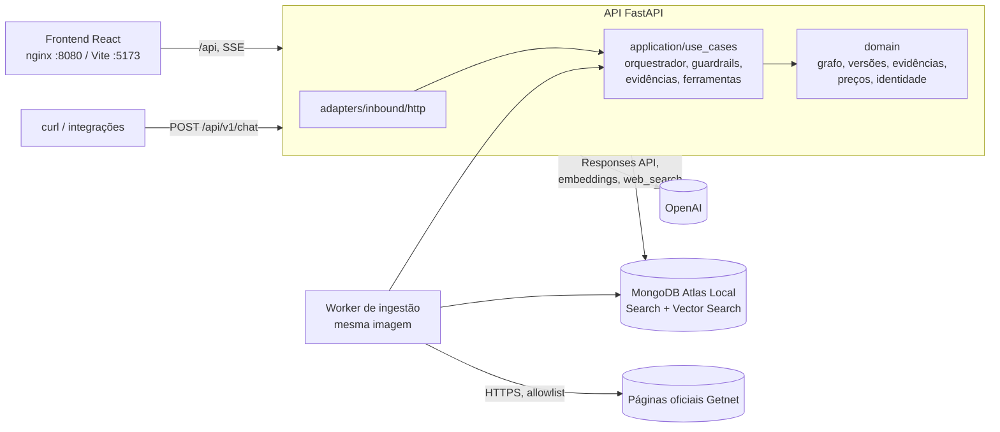
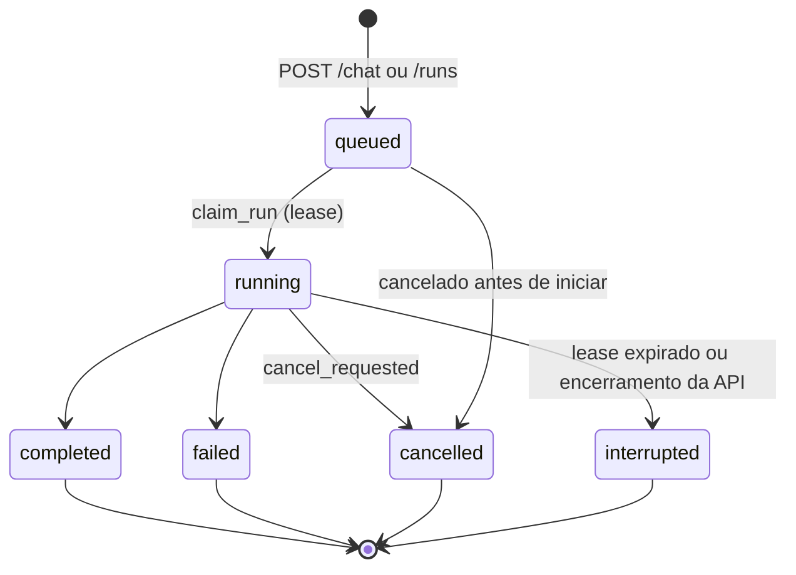

# Arquitetura

Descrição detalhada do sistema como ele está implementado em `backend/src/app`. O README traz a visão geral; este documento traz as camadas, o modelo de dados, a execução durável e as decisões com seus custos. Rotas, eventos e operação ficam em [api.md](api.md), [eventos.md](eventos.md) e [operacao.md](operacao.md).

## 1. Componentes

Processos do Compose: `mongo`, `api`, `worker` e `frontend`. O `worker` usa a mesma imagem da API (`python -m app.adapters.inbound.worker`) e consome a fila de ingestão guardada no Mongo.

## 2. Camadas hexagonais

Monólito modular. A dependência segue `adapters → application → domain`; nenhuma camada interna importa a externa (nenhum módulo de `application/` ou `domain/` importa `app.adapters` ou `app.bootstrap`).

| Camada | Conteúdo | Observação |
|---|---|---|
| `domain/` | `models` (Agent, ModelEvent), `graph` (validação de grafo), `agents` (rascunhos, versões, diff, detecção de segredo), `evidence` (citações `[n]`), `knowledge` (chunking, hashes, versão de índice), `pricing` (tabela versionada), `support`, `identity`, `errors` | Sem SDK, FastAPI nem Mongo. `tests/test_architecture.py` falha se um import proibido aparecer. |
| `application/ports` | `ModelGateway` (stream e embed), portas de suporte, de coleta de páginas (`Fetcher`) e da fila | Protocolos; os adapters os satisfazem. |
| `application/use_cases` | `orchestrator`, `tools`, `guardrails`, `evidence`, `support`, `agents` (administração), `ingest_sources`, `ingest_curated`, `ingestion_jobs`, `knowledge_catalog` | Regras de execução, autorização e ingestão, sem HTTP nem banco. |
| `adapters/inbound` | `http/` (rotas, erros, identidade, verificador OIDC, execução em segundo plano), `cli/` (`apply_indexes`, `ensure_indexes`, `ingest_urls`, `ingest_curated`), `worker.py` | Entradas. `knowledge_wiring.py` e `run_settings.py` compõem configuração e dependências. |
| `adapters/outbound` | `mongo/` (conversas, agentes, conhecimento, suporte, fila, seed, índices de busca), `openai/` (gateway e busca web), `web/` (coleta segura e extração de HTML), `fake/` (modelo enlatado para testes de carga, `MODEL_PROVIDER=fake`) | Saídas. |
| `bootstrap/` | `settings.py` | Configuração. |

O composition root é `adapters/inbound/http/main.py` (ciclo de vida: cliente Mongo, seed idempotente, índices de conversas, tarefa de manutenção) e `execution.py` (`default_runtime` monta gateway OpenAI, repositório de conhecimento e busca web; os testes trocam `app.state.runtime_factory` por doubles).

## 3. Agentes, ferramentas e grafo

Os agentes são dados (rascunho mais versões publicadas), não código. O seed (`adapters/outbound/mongo/seed.py`) cria quatro:

| id | Nome | Tools | Delega para | Papel |
|---|---|---|---|---|
| `router` | Roteador | `delegate_to_agent` | `support`, `knowledge`, `escalation` | Ponto de entrada. Entende a intenção, delega, consolida e escreve a resposta final no idioma do cliente. Não responde por conta própria sobre dados de cliente nem regras da Getnet. |
| `support` | Atendimento ao Cliente | `get_receivables`, `get_terminal_status`, `delegate_to_agent` | `knowledge`, `escalation` | Consulta recebíveis e terminais do cliente autenticado; pede orientação de procedimento ao especialista. |
| `knowledge` | Especialista Getnet | `search_knowledge`, `web_search` | nenhum | Responde com trechos recuperados e citações `[n]`; usa a web só para perguntas gerais e atuais. |
| `escalation` | Atendimento Humano | `request_human_handoff` | nenhum | Encaminha a um operador humano (pedido explícito, falta de evidência ou solução, assunto sensível), informa o protocolo e marca o fluxo como simulação de demonstração, sem prometer prazo. Tipo `custom`. A ferramenta grava um ticket `aberto` em `handoffs` (identidade do backend, um por execução, resumo com números longos mascarados) e devolve `{protocol, status, expected_contact}`. |

Grafo inicial: `router → {support, knowledge, escalation}`, `support → {knowledge, escalation}`, `knowledge → {}`, `escalation → {}`. O modelo de cada agente é `OPENAI_MODEL` no momento do seed; cada agente pode ter `limits` próprios (`max_output_tokens` por chamada, `max_tool_calls` por execução).

Cada agente recebe: as instruções cadastradas, a data e hora atuais (America/Sao_Paulo e UTC), o catálogo de destinos permitidos (id, nome, descrição), as regras de segurança e, conforme as ferramentas, regras de delegação, de dados de suporte e de evidência (`application/use_cases/guardrails.py`). Os prompts completos estão em `seed.py` e são versionados como prompts publicados.

Cinco ferramentas conhecidas (`domain/graph.py::KNOWN_TOOLS`). Definições estritas (`strict: true`, `additionalProperties: false`) em `application/use_cases/tools.py`; o README lista os esquemas.

## 4. Orquestração

Comunicação entre agentes por chamada de ferramenta (`delegate_to_agent`), no mesmo processo. Cada agente é um laço `_converse` sobre o stream da Responses API:

1. Monta `instructions` e a lista de ferramentas oferecidas: só as que estão em `agent.tools` e para as quais existe destino (delegação) ou handler.
2. Consome o stream. `text_delta` do agente raiz vira `response.delta`; `function_call` é acumulado; `completed` traz uso, que vira `usage.recorded` com `cost_usd` e `pricing_version`.
3. Sem chamadas de ferramenta, o agente termina (`agent.completed`) e devolve o texto. Com chamadas, o servidor as executa uma a uma, anexa a saída do modelo e um `function_call_output` embrulhado como dado não confiável e repete.
4. Uma delegação abre um agente filho com `inputs = [{role: user, content: task}]`: o filho não vê a conversa, só a tarefa descrita pelo pai. O texto do filho volta ao pai como resultado da ferramenta.

O modelo pode propor delegar; o servidor valida antes de executar (`orchestrator._call`):

| Verificação | Código de erro | Evento |
|---|---|---|
| Ferramenta não está em `agent.tools` ou não existe | `tool_not_allowed` | `tool.failed` |
| Argumentos não são um objeto JSON | `invalid_arguments` | `tool.failed` |
| Destino fora de `agent.delegates` ou fora do snapshot | `delegation_not_allowed` | `tool.failed` |
| Agente inexistente / já na cadeia (ciclo) | `delegation_invalid` / `delegation_cycle` | `agent.failed` |
| Profundidade, delegações, chamadas de tool, tempo, tokens de saída | `limit_depth`, `limit_delegations`, `limit_tool_calls`, `limit_timeout`, `limit_output_tokens` | `tool.failed` ou `agent.failed`, depois `run.failed` (o tempo limite emite só `run.failed`) |
| Falha do provedor (evento de erro do stream) | `model_error` | `agent.failed`, `run.failed` |

Falha de uma ferramenta de dados (exceção do banco ou do provedor) não derruba a execução: o modelo recebe `{"error": {"code": "tool_unavailable", ...}}` com a instrução de informar a falha sem inventar, e o fluxo emite `tool.failed`. A busca web que devolve `status: unavailable` também emite `tool.failed`, e o modelo recebe esse resultado com a mesma instrução.

Limites padrão (variáveis em `.env.example`):

| Limite | Padrão | Variável |
|---|---|---|
| Profundidade de delegação | 3 | `RUN_MAX_DEPTH` |
| Delegações por execução | 8 | `RUN_MAX_DELEGATIONS` |
| Chamadas de ferramenta por execução | 12 | `RUN_MAX_TOOL_CALLS` |
| Tempo por execução | 120 s | `RUN_TIMEOUT_SECONDS` |
| Tokens de saída por execução (conferido após cada chamada ao modelo) | 16000 | `RUN_MAX_OUTPUT_TOKENS` |
| Execuções ativas por workspace | 20 | `MAX_ACTIVE_RUNS` |

São salvaguardas ajustáveis, não garantia de qualidade. O orçamento de tokens é conferido depois da chamada: uma única chamada pode ultrapassá-lo antes de ser detectada (o teto por chamada do agente, `limits.max_output_tokens`, é enviado ao provedor).

### Snapshot por execução

`execute_run` chama `load_published_snapshot(db, workspace_id)` uma vez: devolve a versão do grafo e os agentes fixados por ela (somente os ativos). A execução usa esse dicionário até o fim; publicar ou restaurar no meio não a afeta. A versão do grafo fica em `runs.graph_version` e a versão de cada agente aparece em `agent.started`.

## 5. Grafo versionado

- **Rascunho** (`agents`): mutável, com `revision` inteira. `PATCH` exige `If-Match`; revisão antiga responde 412 `revision_conflict` com `current_revision`. O servidor rejeita texto com cara de credencial (`secret_detected`, 422).
- **Versões imutáveis**: `agent_versions` (conteúdo completo e resumo), `prompt_versions` (nova só quando as instruções mudam) e `graph_versions` (mapa agente → versão fixada). Restaurar cria uma versão nova com `restored_from`; nada é editado ou apagado.
- **Publicação** (`MongoAgentRepository.commit_publication`): uma transação Mongo que avança `workspaces.graph_version` com compare-and-set (`graph_version == esperado`), grava prompt, versão, ponteiro no rascunho, auditoria e o novo snapshot. Duas publicações validadas contra o mesmo grafo não podem ambas confirmar; quem perde revalida (até 3 tentativas) e, se persistir, recebe 409 `graph_conflict`. Requer replica set (o Atlas Local do Compose é um).
- **Validação** (`domain/graph.py::check_graph`), usada em `POST .../relationships/validate` (não salva) e na publicação: `missing_root` (o `router` precisa existir e estar ativo), `unknown_tool`, `missing_delegate_tool` (tem destinos sem a tool `delegate_to_agent`), `self_reference`, `unknown_destination`, `disabled_destination` e `cycle` (com o caminho). Publicação inválida responde 409 `graph_invalid` e a versão anterior continua ativa.

## 6. Execução durável

- **Criar** (`create_run`): uma transação reserva a conversa (`active_run_id`; uma execução ativa por conversa), insere o run e a mensagem do usuário. Mesma chave e mesmo corpo (hash SHA-256 da mensagem) repetem o run original; corpo diferente é 409 `idempotency_conflict`; conversa ocupada é 409 `conversation_busy`. `POST /chat` gera uma chave nova a cada chamada.
- **Executar** (`execute_run`): a instância que recebeu o pedido executa o run como tarefa assíncrona. `claim_run` leva `queued → running` e grava o dono e o lease (`RUN_LEASE_SECONDS`, 30 s). Um heartbeat renova o lease a cada `RUN_HEARTBEAT_SECONDS` (3 s) e, na mesma volta, lê `cancel_requested`: por isso um cancelamento pedido a outra instância chega ao dono em até ~3 s.
- **Eventos** (`Recorder`): cada evento é uma transação que incrementa `runs.seq` e insere em `run_events` com esse `seq`; deltas de texto são agrupados (200 caracteres ou 0,25 s). `partial_text` acumula o texto. Eventos têm `seq` monotônico e único (teste de concorrência com 25 escritas).
- **Encerrar** (`finish`): uma transação grava o estado terminal, o evento `run.<estado>`, a mensagem do assistente e libera a conversa. O primeiro estado terminal vence: na corrida cancelamento × conclusão só um é gravado.
- **Manutenção**: a cada `MAINTENANCE_INTERVAL_SECONDS` (10 s) cada instância marca como `interrupted` os runs ativos com lease vencido (instância caiu ou travou), preservando o parcial. No encerramento da API, as tarefas locais viram `interrupted` (sem cancelamento pedido). Não há retomada nem nova chamada automática ao modelo: o usuário reenvia com nova chave, o que evita cobrança e ações duplicadas.
- **SSE**: qualquer instância lê `run_events` com polling (`SSE_POLL_SECONDS`, 0,5 s) e emite comentários `: heartbeat` quando ocioso; fechar a conexão não cancela o run. Reconectar em outra réplica funciona porque o estado está no banco (teste `test_reconnecting_on_another_instance_resumes_from_the_shared_database`).
- **Retenção**: TTL no índice de `run_events.occurred_at` (`EVENT_RETENTION_DAYS`, 7). Cursor mais antigo que o primeiro `seq` restante responde 410 antes de abrir o stream; o estado do run continua consultável.

## 7. Coleções e índices MongoDB

Banco `getnet_support` (`MONGO_DATABASE`). Toda consulta privada filtra por `workspace_id` (e `user_id` nos dados do usuário).

| Coleção | Conteúdo | Índices principais |
|---|---|---|
| `workspaces` | Ponteiro do grafo publicado (`graph_version`, o token do CAS) | único `id` |
| `agents` | Rascunhos (com `revision`, ponteiro `published`) | único `(workspace_id, id)`; `(workspace_id, created_at, id)` |
| `agent_versions`, `prompt_versions`, `graph_versions` | Versões imutáveis | únicos por `(workspace_id, agent_id\|prompt_id, version)` e `(workspace_id, version)` |
| `audit_events` | Publicações e restaurações (quem, quando, o quê) | `(workspace_id, at desc)` |
| `conversations`, `messages` | Conversas e mensagens (`sources` nas respostas do assistente) | `(workspace_id, user_id, updated_at desc)`; `(conversation_id, created_at)` |
| `runs` | Estado, lease, `seq`, `partial_text`, `usage`, `trace_id`, `graph_version`, `idempotency_key` | único `(workspace_id, user_id, conversation_id, idempotency_key)`; `(workspace_id, status)`; `(status, lease_expires_at)` |
| `run_events` | Eventos sequenciais | único `(run_id, seq)`; TTL `run_events_ttl` em `occurred_at` |
| `run_evidence` | Trechos recuperados e quais foram citados | único `(workspace_id, user_id, run_id)` |
| `knowledge_sources` | Catálogo (20 fontes) e estado do último índice válido | único `(workspace_id, source_id)` |
| `knowledge_chunks` | Um documento por chunk, com `embedding` | único `(workspace_id, chunk_id)`; `(workspace_id, source_id, chunk_index)`; índices de busca `knowledge_text` e `knowledge_vector` |
| `ingestion_jobs` | Fila durável com lease, tentativas e fases | único `(workspace_id, id)`; `(workspace_id, created_at desc)`; `(status, available_at)` |
| `handoffs` | Tickets de atendimento humano (simulação): `protocol`, `workspace_id`, `user_id`, `conversation_id`, `run_id`, `reason`, `summary`, `status` (`aberto`), datas UTC | único `protocol`; único parcial `(workspace_id, run_id)` (um ticket por execução) |
| `receivables`, `terminals` | Dados fictícios de demonstração | único `(workspace_id, user_id, id)` |

Os índices de busca (Atlas Search/Vector Search) não vão em `mongodump`; recrie-os depois de um restore (veja [operacao.md](operacao.md)).

## 8. Conhecimento: ingestão e recuperação em detalhe

**Origens e catálogo.** `data/knowledge/getnet/manifest.json` descreve as 10 sínteses curadas (`curated_summary`, com hash do corpo verificado na leitura). `data/knowledge/sources.json` lista as 10 URLs oficiais (`official_page`) e a allowlist de domínios (`www.getnet.net`, `site.getnet.com.br`, `getstore.getnet.com.br`). O worker registra as 20 fontes em `knowledge_sources` (status `pending`) ao iniciar.

**Coleta segura** (`web/fetch.py::SafeFetcher`): somente `https`, sem credenciais, porta 443, host na allowlist em cada salto de redirecionamento (máximo 3), resolução DNS que precisa dar somente endereços públicos e conexão ao IP já validado (mantendo `Host` e SNI), corpo limitado (declarado e transmitido, 2 MB), apenas `text/html`. Falhas viram `SourceError` com código estável (`blocked`, `unreachable`, `unsupported_type`, `too_large`, `empty`).

**Fases** (`ingest_sources.py`): `collect → extract → chunk → embed → index`, registradas por fase no job. Uma fonte que falha numa fase sai das seguintes e o erro é gravado; o índice válido anterior só é substituído pela escrita final, atômica (`replace_source` em transação: troca chunks e estado juntos). A fonte fica `stale` se já tinha versão válida, `failed` se nunca indexou. Texto extraído com menos de 200 caracteres falha como `empty` (por exemplo, página cujo texto só aparece via JavaScript). O bloco de conteúdo é o `<main>`; sem ele, um `<article>` só é usado se tiver a maior parte do texto da página, senão o `<body>` (páginas usam `<article>` para cards pequenos).

**Chunking** (`domain/knowledge.py`): divide por títulos, empacota parágrafos até `KNOWLEDGE_CHUNK_MAX_CHARS` (1200) com sobreposição de `KNOWLEDGE_CHUNK_OVERLAP` (150) dentro da seção e descarta blocos repetidos. Cada chunk guarda `chunk_id = <fonte>#<n>`, URL, publicador, região, idioma, `retrieved_on`, limitações, tags, `content_sha256`, `chunk_sha256`, `processing_version`, `index_version` e `embedding_model`. O texto do embedding é título, seção e trecho.

**Idempotência.** `index_version` combina versão de processamento, hash do conteúdo e metadados editoriais (título, URL, limitações). Se o par versão e modelo já está indexado, a fonte é `already_current` e nada é refeito; mudar o conteúdo, o chunking ou o modelo reindexa.

**Fila.** `POST /knowledge/ingestions` e os CLIs criam jobs em `ingestion_jobs`; o worker reivindica o mais antigo com lease (`KNOWLEDGE_JOB_LEASE_S`), renova por heartbeat, aplica timeout (`KNOWLEDGE_JOB_TIMEOUT_S`) e repete com atraso crescente até `KNOWLEDGE_JOB_MAX_ATTEMPTS`. Um worker morto perde o lease e outro assume; esgotadas as tentativas o job vira `failed`.

**Recuperação** (`MongoKnowledgeRepository.hybrid_search`): duas consultas em paralelo, ambas filtradas por `workspace_id` e `embedding_model` (embeddings de modelos diferentes nunca se misturam): `$vectorSearch` no índice `knowledge_vector` (cosseno, 1536 dimensões, `numCandidates = max(100, 10 × busca)`) e `$search` no índice `knowledge_text` (analisador `lucene.portuguese` em título, seção e texto). Cada uma devolve `max(2 × limite, 10)` candidatos; a fusão é reciprocal rank fusion com `k = 60`, chaveada por `chunk_id`, e devolve 5 trechos. O `score` é uma pontuação de posição, não uma probabilidade de acerto.

**Evidências** (`application/use_cases/evidence.py`). Cada trecho ou fonte web ganha um `evidence_id` único na execução (não reinicia a cada busca). O modelo recebe o trecho com `cite_as: "[n]"`; os eventos carregam só `evidence_id, kind, title, url, retrieved_on` (nunca o texto). No fim, `resolve()` extrai as citações `[n]` (1 a 3 dígitos, para não confundir com anos) e separa válidas (foram recuperadas na execução) de inválidas. `run_evidence` guarda tudo recuperado com a marca `cited`; `GET /runs/{id}/evidence` expõe `retrieved`, `cited` e `invalid_citations`. A resposta persistida só traz como `sources` as válidas.

## 9. Correlação, uso e custo

A observabilidade usa OpenTelemetry e o stack Grafana LGTM (serviço `observability` do Compose, `grafana/otel-lgtm`). Abra o painel em http://localhost:3000/d/getnet-atendimento. O que existe:

- **Traces e métricas** (`bootstrap/telemetry.py`): `setup_telemetry(app, settings)` exporta por OTLP/HTTP (`OTEL_EXPORTER_OTLP_ENDPOINT`) e instala um middleware HTTP (span por requisição com a rota como modelo, `X-Trace-ID` na resposta; health checks ignorados). `traced_emit` envolve o emissor de eventos de cada execução e produz a hierarquia `run` > `agent` > `tool`, métricas (`getnet.runs`, durações, tokens, custo estimado, chamadas sem custo) e logs estruturados. Só identificadores, nomes, contagens, durações, tokens e custo entram; nunca mensagens, argumentos, resultados ou trechos. Falha da telemetria nunca afeta o fluxo.
- **Correlação**: `trace_id` é o id do trace da execução (32 hex), gravado em `runs.trace_id` e devolvido em `POST /chat` e `GET /runs/{id}`; para achar o trace, cole-o em Explore > Tempo > TraceID. `X-Request-ID` identifica cada requisição HTTP e aparece nos erros `{code, message, request_id}`.
- **Logs**: o processo registra só avisos e falhas (`logging`); os eventos estruturados de execução vão ao Loki com `run_id` e `trace_id`, sem conteúdo de mensagens.
- **Custo**: `domain/pricing.py` com `PRICING_VERSION` e uma tabela pequena. O modelo padrão `gpt-6-luna` tem preço cadastrado (US$ 0,10 entrada / US$ 0,50 saída por 1M tokens, referência 17/10/2026). Um modelo fora da tabela gera `cost_usd` `null` em cada `usage.recorded`, o `usage.cost_usd` da execução também fica `null` (uma chamada sem preço torna o total desconhecido) e a interface mostra "não informado", nunca 0. Tokens e custo aparecem em "Detalhes técnicos" do painel.

## 10. Decisões e trade-offs

| Decisão | Por quê | Custo ou alternativa | Quando rever |
|---|---|---|---|
| Python/FastAPI hexagonal em monólito modular | Fronteiras claras sem custo de microsserviços; domínio testável sem SDK | Mais arquivos que um script único | Se um módulo precisar de escala ou ciclo de deploy próprio |
| Responses API direto, sem framework de agentes | O laço de agentes cabe em um módulo, o servidor mantém o controle (validação, limites, snapshot, eventos) | Streaming, tools e retomada ficam por nossa conta | Se fluxos complexos (paralelismo, memória longa) pedirem mais do que o laço atual |
| Delegação como ferramenta (`delegate_to_agent`) | O modelo escolhe, o servidor valida vínculo, ciclo e limites; o fluxo fica visível em eventos | O filho só vê a tarefa descrita pelo pai (precisa ser autocontida) | Se for preciso compartilhar histórico entre agentes |
| MongoDB Atlas Local com Search e Vector Search | Um banco para documentos, busca textual, vetorial, eventos e fila; transações no replica set | Atlas Local é só desenvolvimento; produção exige Mongo compatível com Search | Ao escolher o deployment de produção (Atlas gerenciado ou self-managed) |
| Busca híbrida com RRF | Combina termos exatos (modelos, códigos) e semântica sem calibrar pesos de pontuações incomparáveis | `k = 60` e top 5 fixos no código | Ao medir recall nos dados de avaliação |
| Eventos no Mongo com polling | Replay, retomada multi-instância e auditoria com uma única fonte de verdade | Latência até 0,5 s e leitura periódica por conexão | Se benchmark mostrar custo de leitura ou fan-out alto: change streams ou broker |
| Fila de ingestão no Mongo | Jobs longos fora da API sem novo componente; lease, retry e idempotência no banco | Sem backpressure nem replay de broker | Se volume ou múltiplos consumidores exigirem |
| Sem Redis, sem Kafka | Nenhuma medição mostra gargalo de leitura, limite distribuído ou pub/sub de alto volume | Quotas em Mongo; sem cache | Só depois do benchmark (veja [capacidade.md](capacidade.md)) |
| OpenTelemetry + Grafana LGTM | Traces por execução, métricas de latência, tokens e custo e logs sem conteúdo, num único contêiner no Compose | Mais um contêiner em desenvolvimento; exportação opcional e tolerante a falhas | Ao ir para produção: coletor e retenção gerenciados |
| Sem conteúdo em logs | Privacidade por padrão: logs de erro com identificadores, sem mensagem do cliente | Depurar conteúdo exige a base de runs e eventos | Se for preciso captura de conteúdo: opt-in explícito |

## 11. Diferenças em relação ao desenho original

Pontos em que o código ainda não cumpre o que o `design.md` descreve, ou cumpre de outro modo:

- O modelo recebe apenas a mensagem atual: o histórico persiste e é exibido, mas não é reinjetado nas chamadas ao modelo. Cada execução é independente.
- `usage.recorded` cobre as chamadas dos agentes. O hook `_usage` do orquestrador (para embeddings da consulta) existe, mas o adapter OpenAI não o preenche, e a chamada da busca web hospedada não informa uso. Tokens e custo por execução excluem essas duas chamadas.
- O limite de execuções ativas por workspace é contar e inserir, não atômico: uma rajada pode ultrapassá-lo um pouco (comentário `shortcut` no código). A quota atômica compartilhada é a tarefa 9.3.
- `GET /conversations` devolve até 100 itens e `GET /conversations/{id}/messages` até 500, sem cursor (a paginação por cursor existe em `/agents` e nas listas de versões).
- O envelope SSE não tem `parent_event_id`. Streams lentos não usam buffer próprio com desconexão: o gerador lê o banco no ritmo do cliente.
- O top-k da busca (5) é fixo no código; não há orçamento de contexto configurável por variável (cada trecho entra no contexto limitado a 2000 caracteres).
- Não há coleções `users` nem `demo_customers`: os dados de demonstração são `receivables` e `terminals` por `(workspace_id, user_id)`. `run_evidence` é novo.
- O quarto agente opcional (escalonamento humano) foi implementado como simulação: `escalation` registra um ticket em `handoffs` e devolve um protocolo, sem fila de atendimento real. Um classificador de moderação separado não foi implementado.
